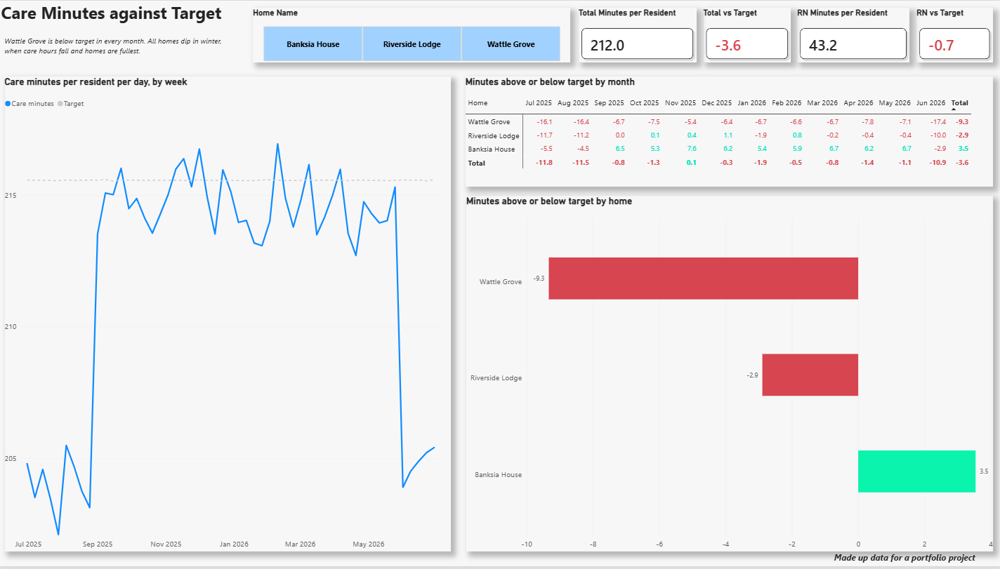
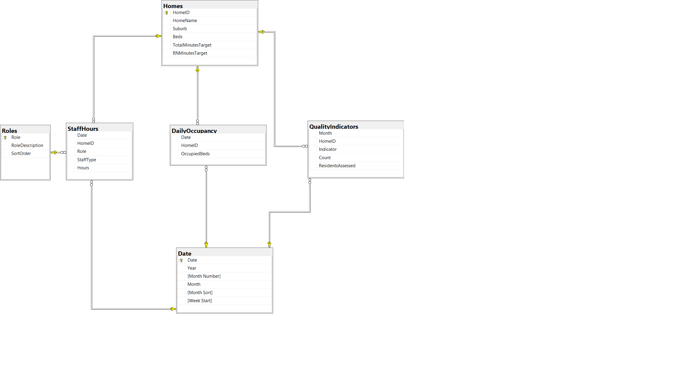
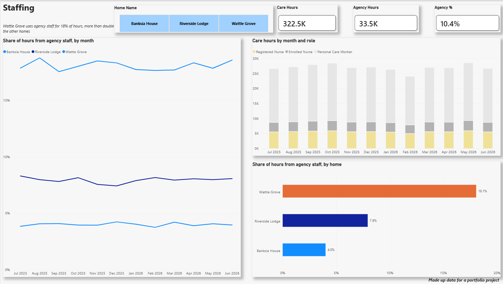
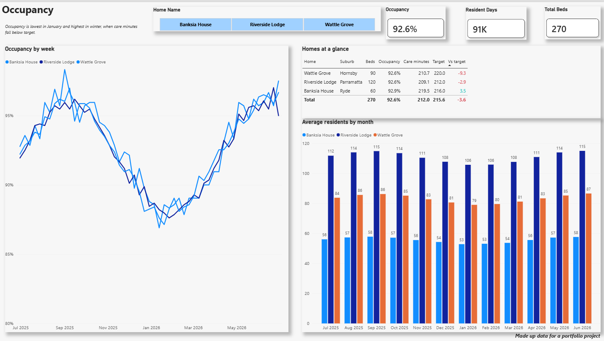
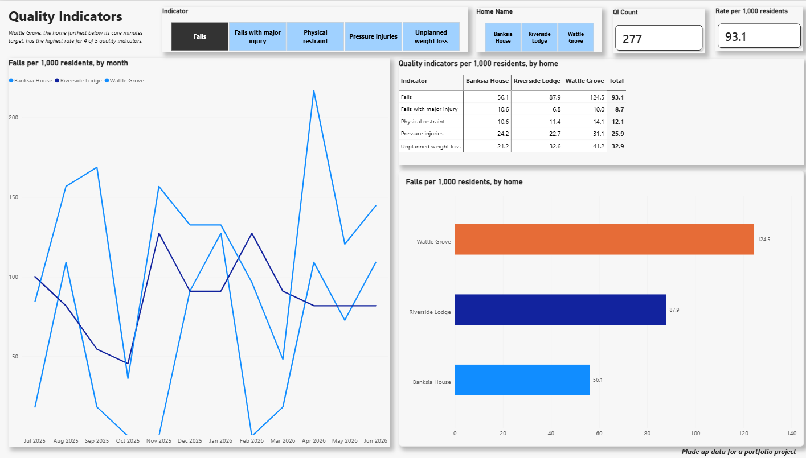

# Aged Care Care Minutes Dashboard (SQL Server and Power BI)

A portfolio project that tracks care minutes against target for three aged care homes over one financial year (Jul 2025 to Jun 2026). The data is stored and modelled in SQL Server and reported in Power BI.

> All data in this project is made up. The homes, residents and figures are not real.
>
> © 2026 Jehan Vijay. All rights reserved. You are welcome to view this work. Please do not copy, reuse or republish it without my permission.



## The question

Are our homes meeting their care minutes targets, and if not, why?

The report answers this over four pages:

1. **Care Minutes against Target:** care minutes per resident per day, compared with each home's target.
2. **Staffing:** care hours by role and how much of the work is done by agency staff.
3. **Occupancy:** how full each home is through the year.
4. **Quality Indicators:** falls, pressure injuries, physical restraint, unplanned weight loss and falls with major injury, per 1,000 residents.

## Key findings

* **Wattle Grove is below target in every month.** It averages 9.3 minutes per resident per day below its target. Banksia House is 3.5 minutes above target.
* **All homes dip below target in winter.** I checked this in SQL. Resident numbers stay about the same, but care hours drop by around 7% in winter months, and homes are at their fullest then.
* **Wattle Grove relies most on agency staff.** 18.1% of its care hours come from agency staff, compared with 7.9% at Riverside Lodge and 4.0% at Banksia House.
* **Wattle Grove has the highest rate for 4 of the 5 quality indicators.** Its falls rate is more than double Banksia House (124.5 compared with 56.1 per 1,000 residents). This shows the two go together. It does not prove that fewer care minutes cause more falls.
* **Occupancy is lowest in January** (about 88%) and highest in winter (about 96%).

## How it was built

### SQL Server

* Database: `CareMinutes` on SQL Server 2025 Developer Edition.
* Star schema with three fact tables and three dimension tables:

| Fact tables | Dimension tables |
|---|---|
| StaffHours (hours by home, day, role and staff type) | Homes (beds, suburb, targets) |
| DailyOccupancy (occupied beds by home and day) | Date (built in SQL with GENERATE_SERIES) |
| QualityIndicators (monthly counts by home and indicator) | Roles (role code, description and sort order) |

* Primary keys on the dimension tables and foreign keys from every fact table, so bad data cannot be loaded.
* Changed `Hours` from `float` to `decimal(6,1)` to fix rounding problems (for example 37.40000153 instead of 37.4).
* Wrote a validation query that works out minutes per resident per day and the gap to target by home and month. The results matched the Power BI report exactly.



### Power BI

* Connected to SQL Server (Import mode). Power BI uses the same table and column names as the database.
* DAX measures for care minutes per resident, gap to target, agency share, average residents and quality indicator rates.
* Red and green colour rules for above and below target.
* Chart titles that change with the slicer (for example "Pressure injuries per 1,000 residents, by month").
* Home slicer synced across all pages, with multi select.
* Months sorted in calendar order using a Month Sort column.

## Report pages

| | |
|---|---|
|  |  |
|  | |

## Files in this repo

```
README.md
CareMinutes.pdf           PDF copy of the four report pages
sql/
    01_date_table.sql     Builds the Date table
    02_roles_table.sql    Builds the Roles table
    03_keys.sql           Primary and foreign keys
    04_fix_data_types.sql Changes Hours to decimal
    05_validation.sql     Checks the report against the source data
images/
    care-minutes.png
    staffing.png
    occupancy.png
    quality-indicators.png
    star-schema.png
```

## Report file

A PDF copy of all four report pages is included (`CareMinutes.pdf`). The Power BI report file (.pbix) is not included in this repo. I am happy to share it or walk through it in an interview. Please contact me through GitHub or LinkedIn.

## What I would add next

* Care hours per day, so short months like February do not look like a staffing drop.
* An Indicators dimension table with descriptions and sort order.
* Quarterly views of the quality indicators, since monthly counts are small and jump around.

## Copyright

© 2026 Jehan Vijay. All rights reserved.

This repo is shared so people can see my work. No licence is given to copy, change, reuse or republish any part of it, including the SQL scripts, the report design and the images.
